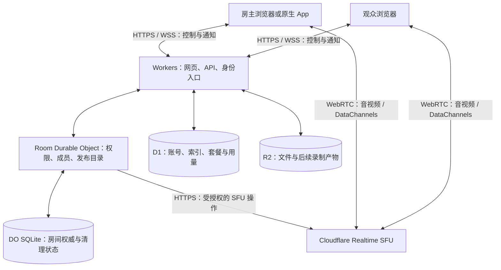

# piik-worker：产品理解与 Cloudflare 架构研究

初始选型记录。后续实现和验证状态以[项目 README](../README.md)为准。

研究日期：2026-10-25。本文是可行性分析和建议方案，尚未实现或部署。
产品依据为本地 Piik `066e218`、Cloudflare Meet `314d424`，服务能力和价格依据研究当天的官方资料。

## 1. 结论与产品方向

可以用 Cloudflare 承载一个类似 Piik 的托管服务：Workers 提供网页和 API，Durable Objects 管理房间，Realtime SFU 传输音视频，按需增加 D1、R2 等存储。

建议将 piik-worker 定义为：**面向朋友小群体的私密实时共享空间，一位房主、最多 20 位观众，打开链接即可一起看、一起聊。**

第一版建议采用 SFU 为主的媒体路径。这是一项新产品取舍：保留 Piik 的使用体验，减少对原版 P2P 分发树、浏览器中继和自建 SFU 的依赖；代价是媒体出站费用和对 Cloudflare 的媒体服务依赖。若要求完整保留 Piik 的 P2P-first 特性，需要另做混合路由设计，不能称为简单迁移。

网站、房间后端和媒体基础设施可以全部部署在 Cloudflare。操作房主电脑、原生采集等功能仍需要运行在用户设备上的 App；账号身份提供方、收款等商业服务也应按需要另选。

## 2. Piik 实际是什么

Piik 是免费开源、支持自部署的私密屏幕共享软件，MIT 许可。它有托管在线入口和本地 App，但其核心产品模型不是企业会议、公开直播平台或完整的商业订阅系统。[项目介绍](https://github.com/TNTcraftHIM/Piik)、[官网](https://piik.tv/)。

| 维度 | 原版 Piik 的产品含义 |
| --- | --- |
| 使用场景 | 朋友看游戏、电影、绘画、照片，边看边聊 |
| 房间角色 | 一位 Host，最多 20 位经过房间授权的 Viewer；授权不等于必须注册账号 |
| 分享来源 | 浏览器屏幕、窗口、标签页、摄像头；App 增加原生采集能力 |
| 进入房间 | 邀请链接、房间号、可选密码；房主所有权和观众邀请分离 |
| 房间互动 | 文字、表情、弹幕、房间语音 |
| 远控共玩 | 房主明确授权后，通过 App 操作键鼠和受支持的手柄；有平台边界 |
| 观看体验 | 浏览器观看、播放与音量控制、画中画、主题和连接状态 |
| 网络设计 | P2P 优先，包含观众中继；自部署可开启嵌入式 SFU 兜底 |
| 服务端 | Go 核心，内嵌网页、房间管理、STUN 和可选媒体转发；Hosted 默认 SQLite |

官网在线 Demo 当前注明媒体转发关闭，因此“页面能打开，但受限网络下视频不通”是已有边界。原版也没有把可授权远控等同于所有平台都已完整验证：本地 TODO 仍列有远控端到端延迟、原生采集和部分虚拟手柄的验证工作。[在线版说明](https://piik.tv/#get-started)。

其“共同观看”主要是大家看房主传来的同一幅实时画面。每个观众本地暂停或调音量，与同步控制各自的视频播放器、共同拉取同一个影片文件，是不同的功能模型。

Piik 的“私密”首先指房间准入和授权。原版产品标准明确：经中继或 SFU 的媒体不是对该中继或运营者不可见的端到端加密。

## 3. 如何选择 Cloudflare 服务

### 核心与存储职责

| 服务 | piik-worker 中的职责 | 引入时机 |
| --- | --- | --- |
| Workers + Static Assets | 前端资源、HTTP API、认证入口、调用 SFU API | 第一版 |
| 每房间一个 Durable Object | 房主、成员、20 人上限、邀请版本、发布目录、信令通知、资源清理 | 第一版 |
| DO SQLite | 持久保存房间权威状态、授权版本和未完成清理记录 | 第一版 |
| Realtime SFU | 共享画面、源音频、各成员麦克风、后续远控 DataChannels | 第一版 |
| Cloudflare TURN | 为连接不通的端点提供 WebRTC 中继；由后端签发短期凭据 | 连通性验证时 |
| D1 | 用户/租户、房间列表索引、套餐、用量汇总、录制元数据 | 账号与 SaaS 阶段 |
| R2 | 用户上传文件、客户端安装包、后续录制文件 | 确有文件功能时 |
| KV | 容忍传播延迟的配置或非权威缓存 | 有具体需要时 |
| Queues | 用量事件、邮件任务、文件后处理；消费者处理重复投递 | 异步任务出现时 |
| Workflows | 多步骤录制后处理等持久任务编排 | 相应功能出现时 |
| Turnstile、速率限制 | 减少匿名建房、密码尝试和接口滥用 | 开放公网时 |
| Workers Logs / Analytics Engine | 服务错误、媒体诊断事件和产品指标 | 先用必要日志，按需要扩展 |

不必为了“全用 Cloudflare”把所有存储都接上。**实时共享本身不需要把视频保存到 R2，也不需要每帧写数据库。** 新网站优先使用 Workers Static Assets。[Workers 静态资源](https://developers.cloudflare.com/workers/static-assets/)。

DO 是房间权限的唯一权威；D1 中的房间列表只是查询索引。不要让两边同时决定谁是房主、谁仍有观看权限。DO 存储与 D1 之间也不存在可以直接假定的跨服务原子事务，索引更新应允许幂等重试。

KV 最终一致，适合读多写少且容忍延迟的数据，不适合踢人、撤销邀请、人数上限等实时决策。[KV 一致性说明](https://developers.cloudflare.com/kv/concepts/how-kv-works/)。

### SFU、RealtimeKit、Stream 的取舍

| 方案 | 对这里的价值 | 判断 |
| --- | --- | --- |
| Realtime SFU | 自己控制房主/观众、订阅轨道、音频行为和远控；Cloudflare 管媒体基础设施 | 最符合自定义 Piik 产品的方向 |
| RealtimeKit | 提供会议 SDK、预制 UI、录制和转写，减少会议功能开发 | 若目标改成会议产品，或交付速度优先于自定义体验，可重新比较 |
| Stream Live | 适合少数主播向大量主要观看的观众播出 | 将来扩展大规模只看直播时再评估 |

RealtimeKit 不只是一个 UI 组件，SFU 也不包含完整会议后端。选低层 SFU，就要自己承担权限、信令、发现和生命周期。Stream 另有 WHIP/WHEP WebRTC 路径，不能笼统说所有 Stream 都是高延迟；但它仍不提供这里需要的完整房间语音与远控模型。[Realtime 产品边界](https://developers.cloudflare.com/realtime/)、[Stream WebRTC 能力与限制](https://developers.cloudflare.com/stream/webrtc-beta/)。

## 4. 推荐架构



**控制路径：客户端 ↔ Worker / DO。媒体路径：客户端 ↔ SFU。** 不把音视频字节经房间 WebSocket 广播，也不尝试在普通 Worker 内运行原版 Go/Pion/LiveKit 的媒体服务器。Workers 在这里调用托管 SFU 的 HTTPS API。[SFU 架构](https://developers.cloudflare.com/realtime/sfu/concepts/architecture/)。

房主发布一次逻辑视频轨道，SFU 分发给观众。房主上传不会随观众人数线性增加，但启用 simulcast 会发送多个编码层，仍增加上行与编码成本。房间语音则是每位主动开麦者发布音频，其他已加入语音的成员订阅；共享源声音与麦克风保持独立，避免把音乐套用语音降噪，也避免重复播放。[Simulcast](https://developers.cloudflare.com/realtime/sfu/features/simulcast/)。

浏览器可按发布、接收分别使用 PeerConnection，以分开两套协商生命周期；这不是 SFU 的强制要求。Cloudflare 当前 video-room 示例就采用这一路径。[官方房间示例](https://developers.cloudflare.com/realtime/sfu/examples/video-room/)。

### 房间和资源生命周期

1. **创建与加入。** 后端创建随机房间身份、房主权威和高熵观众邀请。短房间号仅作定位，不能当秘密；原版四位码最多只有 9,000 个可分配值，新 SaaS 不宜直接沿用为全局身份。邀请可放在 URL fragment，读出后交换为当前房间成员凭据，避免进入普通 URL 请求日志。
2. **权限检查。** Room DO 检查 Host/Viewer、房间实例、邀请版本和人数。App Secret 只放 Worker secret；客户端持有应用自己的有限凭据。SFU 的 sessionId、trackName 是定位符，不是访问权限。
3. **发布与订阅。** 客户端创建 SDP，经后端完成 SFU 操作。DO 只将成功的发布加入目录；观众按应用发布 ID 申请订阅，服务端解析成允许的 SFU 资源，禁止任意代理客户端提供的 SFU 路径和 sessionId。
4. **协商顺序。** 每个 SFU session 的修改串行执行；需要立即重新协商时先完成 offer/answer。检查顶层和每条轨道的错误，不能把 HTTP 200 当作整批成功。
5. **断线与恢复。** 区分房间身份、成员身份、连接尝试和共享代次。短暂通知连接断开不等于媒体已断；也不能因媒体仍在播放就无限延长已失效授权。新连接拒收旧代次响应，迟到的资源分配仍须清理。超过可复用窗口时重新发布并重建订阅。
6. **踢人、撤销和停止。** 先持久化权限变化并阻止新申请，再关闭对应 SFU 订阅/轨道和 DataChannels。仅移除成员列表、关闭通知 WebSocket或隐藏视频，不会撤销已有媒体订阅。未成功清理的资源保留私有记录，通过有界重试继续关闭。

以上边界来自 [SFU 最佳实践](https://developers.cloudflare.com/realtime/sfu/best-practices/)和[协商与恢复说明](https://developers.cloudflare.com/realtime/sfu/concepts/negotiation/)。

DO 使用 WebSocket Hibernation，空闲时可以保留连接并释放内存。房间权威写 SQLite，连接附件保存必要的当前成员关联；重建时恢复状态并核对有效连接，不能依赖内存 Map 永久存在，也不能把数据库中的旧成员直接认定为在线。[DO Hibernation](https://developers.cloudflare.com/durable-objects/best-practices/websockets/)。

### 当前值得纳入设计的 SFU 限制

- 每 session 每秒最多 50 次 API 请求；一次添加最多 64 条轨道。20 位观众是产品规则，不是 Cloudflare 的房间限制。
- 媒体轨道连续 30 秒没有入站媒体包会被回收；失去 WebRTC 连通性后有 30 秒的 session/track 复用窗口。这两种情况不等于所有空闲房间统一 30 秒过期。
- SFU 支持 H.264/H.265/VP8/VP9/AV1，以及 Opus 等音频；端点能力另算，不能承诺某编码在所有浏览器可用。第一版可优先验证 H.264/VP8 + Opus。
- 同一个发布 DataChannel 最多有一个订阅者拥有 `canReply`。多人共玩不能直接让所有观众回复同一个 Host 通道；可让获授权观众分别发布输入通道，由 Host 订阅并逐个验证授权。

来源：[SFU limits](https://developers.cloudflare.com/realtime/sfu/platform/limits/)、[DataChannels](https://developers.cloudflare.com/realtime/sfu/features/datachannels/)。

## 5. Cloudflare 无法替代的客户端能力

**系统采集。** `getDisplayMedia()` 需要用户操作、选择来源和授权；`audio: true` 不保证有系统声音。操作系统、浏览器和共享来源共同决定结果。移动浏览器观看与移动浏览器分享屏幕也不是同一能力。先限定并验证桌面浏览器 Host，移动设备优先作为 Viewer。[浏览器采集边界](https://developer.mozilla.org/en-US/docs/Web/API/MediaDevices/getDisplayMedia)。

**远程控制。** 浏览器可以捕获观众键鼠并传输事件，但执行房主电脑上的系统输入需要原生 App 及系统授权。应绑定当前分享来源与控制授权，断线、切换来源或撤销后释放按键；本地 App 也要独立检查授权，不能只依赖网页按钮或后端状态。

**高画质与低延迟。** SFU 负责转发，不能假定它会自动生成所有分辨率或解决设备编码瓶颈。先验证 1080p 30/60 fps、音画同步和不同接收端，再决定 simulcast。4K、高帧率和端到端延迟都应以测量为准。

**隐私。** 邀请链接、HTTPS 和 WebRTC 传输加密不自动提供针对 SFU 运营者的媒体 E2EE。若要更强承诺，需要额外的媒体加密、成员密钥更新和兼容性设计；Meet 已有 MLS + 客户端媒体加密可作参考，但不应只复制开关就宣称完成安全目标。[Cloudflare 的 E2EE 实现说明](https://blog.cloudflare.com/orange-me2eets-we-made-an-end-to-end-encrypted-video-calling-app-and-it-was/)。

**网络可达性。** Cloudflare 全球网络不等于每种校园网、企业网、运营商或中国大陆链路都具有可接受的媒体体验。实际用户所在地必须分别验证网页、WSS、直连 SFU、TURN 的可达性与持续质量。当前研究未做这些实测。

**录制。** R2 只保存文件，不会自动录制 SFU。简单方案可以是用户主动在客户端录制并上传；可靠的云端录制需要单独验证录制端、封装/编码、失败恢复和费用。RealtimeKit 提供托管录制，但选择底层 SFU 时不能直接假定继承该能力。SFU WebSocket adapter 的视频输出是 JPEG 帧、音频是 PCM，不应把它直接当成高保真音视频文件录制接口。[媒体适配器](https://developers.cloudflare.com/realtime/sfu/features/media-transport-adapters/)。

## 6. 成本：主要变量是观众累计观看流量

研究当天官方价格：SFU / TURN 出站为 **$0.05/GB**，每月前 **1,000 GB** 为两者共享免费额度；SFU 入站免费。Cloudflare 自家 TURN 与 SFU 间的流量不重复计费。Workers、DO、存储和其他产品另算。[Realtime 定价](https://developers.cloudflare.com/realtime/sfu/platform/pricing/)。

估算使用十进制 GB，假定每位观众收到的平均总媒体码率为 B Mbps，N 位观众持续观看 H 小时：

```text
媒体出站 GB ≈ 0.45 × B × N × H
月度 SFU/TURN 费用 ≈ max(0, 账户月度计费出站 GB − 1000) × $0.05
```

| 平均接收码率 | 观众 | 持续时间 | 估算出站 | 免费额度用完后的增量费用 |
| --- | ---: | ---: | ---: | ---: |
| 3 Mbps | 5 | 1 小时 | 6.75 GB | $0.34 |
| 6 Mbps | 10 | 1 小时 | 27 GB | $1.35 |
| 6 Mbps | 20 | 1 小时 | 54 GB | $2.70 |
| 10 Mbps | 20 | 1 小时 | 90 GB | $4.50 |

例如，20 位观众平均接收 6 Mbps，每天看 2 小时、30 天约为 3,240 GB；假定账户免费额度全部用于此处，媒体费约 **$112/月**。按同一条件，1,000 GB 只够约 **18.5 个满员房间小时**，不是无限免费。

表格不是 1080p 的固定码率承诺。若 B 只计视频，还需加源音频、语音和网络协议开销；多人同时开麦也产生多份音频出站。实际费用以供应商计量为准，客户端 `getStats()` 用于诊断，不能直接当作可信账单。

Workers Paid 当前账户最低 **$5/月**，包含一定用量，超过额度另计；这不是整套 SaaS 的固定总价。[Workers 定价](https://developers.cloudflare.com/workers/platform/pricing/)。R2 免费出站和 Workers 的带宽规则不能用来抵消 Realtime SFU 费用。

商业上适合围绕房间时长、并发观众和画质额度设计套餐。开放匿名无限建房、无限观看会暴露实际带宽成本。P2P 能减少 SFU 出站，但增加端点上行、连接和恢复复杂度；先拿到真实使用与成本数据，再判断是否值得引入混合路径。

## 7. 如何利用已有代码

| 参考 | 值得复用或研究 | 需要替换或补齐 |
| --- | --- | --- |
| 本地 Piik | 使用流程、Host/Viewer 分工、播放器、房间互动、视觉组件、音频语义、采集经验 | Go 房间后端迁到 Worker/DO；媒体信令适配 CF API；原拓扑不能原封不动保留 |
| 本地 cloudflare/meet | React 界面、PartyTracks 集成、Room DO、SFU 联调、E2EE 研究 | 会议布局改为主画面与观众；房间授权、配额、撤销和清理按产品重新确认 |
| 官方 realtime-examples/video-room | 当前的 SFU API、身份边界、独立发布/接收连接、恢复与清理 | 示例本身是实验性蓝图；其 Cloudflare Access 身份需适配面向朋友或公众的登录/邀请 |

具体源码观察：Piik 的 `host-sfu-route.ts` / `viewer-sfu-route.ts` 依赖原版共享协议和路由切换；不能只改一个 SFU URL。Meet 的 `partytracks.$.tsx` 提供媒体 API 代理入口，`ChatRoom.server.ts` 协调房间，当前 hibernation 选项仍是注释；不能直接把 Demo 当作权限、休眠成本和生命周期均已满足要求的生产底座。

推荐：**以 Piik 定义体验，以当前官方 video-room 校验媒体边界，选择性参考 Meet，建立独立 piik-worker。** 不建议把 Piik 的 Go 服务编成 WASM 塞进 Worker，也不建议同时保留两套完整客户端状态机。

参考：[Meet](https://github.com/cloudflare/meet)、[video-room 与生产接入说明](https://github.com/cloudflare/realtime-examples/blob/main/video-room/PRODUCTION.md)。复用 Piik 的 MIT 代码和 Meet 的 Apache-2.0 代码时保留相应版权、许可与适用声明；公开产品的品牌另行处理。

## 8. 分阶段落地与验证

### A. 验证媒体与授权闭环

先完成一位 Host、一个 Viewer 的真实屏幕和声音，再扩到 20 位观众。验证连通、首帧、音画同步、权限撤销、断线恢复、清理和使用成本。采用 Workers + Room DO + SFU；这一步回答基础架构是否适合目标用户。

关键场景包括：并发加入不越过人数限制；观众不能发布共享视频或订阅其他房间；踢人后已有媒体确实停止；超过 30 秒恢复时重建资源；DO 休眠/重建不恢复过期权限；API 部分失败和迟到响应不会留下持续收费的资源。

### B. 做出完整的 Web 共享产品

加入房间邀请与密码、Host/Viewer 界面、独立源音频与房间语音、聊天表情、移动观看和清楚的连接状态。桌面浏览器 Host 的采集范围按实测公布；暂不将原生远控当成纯网页功能承诺。

### C. 完成 SaaS 经营层

引入主持人账号、房间列表、套餐、配额、账单入口、用量对账与滥用控制。D1 承担全局查询数据，Room DO 仍拥有实时房间权限。登录可以接 OIDC，也可按需要实现应用身份；Cloudflare Access 更适合内部或受控部署，不能直接等同于完整的公众客户账号系统。支付服务也需另行集成。

配额要在后端创建资源前执行，不能仅靠 UI；用量异步汇总需去重，账单和付款 Webhook 也需幂等。后台查看权限和访客加入权限保持分离。

### D. 按实际需求增加增强能力

原生 App、系统音频、远控共玩、E2EE、录制回放，以及有成本依据的 P2P/SFU 混合路径，各自有独立的设备和生命周期验证。没有证据前，不把第一版称作原版 Piik 的完整功能等价替代。

验证优先用真实设备与链路；无头浏览器的模拟媒体不能证明真实的系统音频、硬件编码和低延迟远控。针对中国大陆和跨境场景，应在上述 A 阶段尽早测量，避免完成大量界面工作后才发现服务链路不适合。

## 9. 当前仓库与工具选择

工作区外层是容纳多个仓库的目录：`Piik/` 为原版参考，`meet/` 为官方参考，`piik-worker/` 为新仓库，研究开始时没有提交和应用代码。本轮仅在新仓库写入本文。

新项目没有 Wrangler 配置，后续应采用 `cf` 和 `cloudflare.config.ts`。本机已确认 `cf 1.0.0-beta.19`，通过 `cf cli search` 找到并用 schema/help 核对了 `cf realtime sfu apps create`；本轮未创建 Cloudflare 资源。

`meet/` 已有 `wrangler.toml`，若单独运行该参考项目，继续使用它现有的 Wrangler 流程，不为研究统一迁移。后续实施时再按当前命令发现、配置 schema 和 dry-run 核对部署步骤。[cf 使用说明](https://developers.cloudflare.com/cf/agents/)。

尚未验证：当前账户是否已开通全部所需服务、真实链路质量、浏览器音频兼容性、20 人实际承载质量，以及云端录制方案。本文对可行性的判断来自产品职责、公开能力和代码结构，不代表已经完成生产验收。
